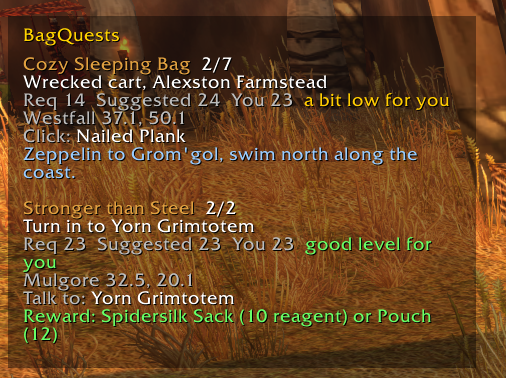
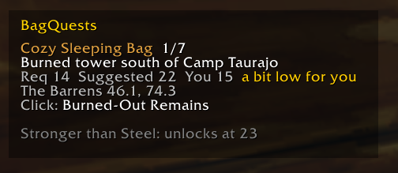
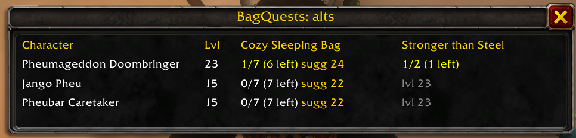

# BagQuests: Forever (beta 0.2.0)

Tracks the WoW Forever quest chains that reward bags. It shows your next step on
screen (RestedXP style), puts pins on the world map and minimap, and has an
optional alts table.

Questlines so far (every one rewards a bag of 10+ slots):

| Bag | Slots | Faction | Req level |
| --- | --- | --- | --- |
| Old Toolbox / Sturdy Lunchbox, on the way to the **Cozy Sleeping Bag** | 12 | both | 14 |
| **Deviate Hide Pack** (Wailing Caverns hides) | 10 | both | 13 |
| **Hunting Satchel** (Vyrin's Revenge, Loch Modan) | 10 | Alliance | 11 |
| **Gunnysack of the Night Watch** (Duskwood) | 10* | Alliance | 18 |
| **Ooze-covered Bag** (Menethil Harbor) | 10* | Alliance | 19 |
| Spidersilk Pouch / Sack (**Stronger than Steel**) | 12 / 10 reagent | Horde | 23 |
| **Explorer's Knapsack** (Cortello's Riddle) | 14* | both | 35 |
| **Thawpelt Sack** (The Platinum Discs, Uldaman) | 14* | both | 40 |
| **Hyjal Postal Satchel** (new in Forever) | 18 | both | 56 |

\* Slot count from Classic sources, not yet confirmed in Forever. Quest IDs and
coordinates come from the Forever Questie database; `/bq verify` confirms them in game.

**Download:** [BagQuests: Forever on CurseForge](https://www.curseforge.com/projects/1808477)
(awaiting CurseForge approval; the link works once the project is live).
Source and issues: this repo.

## Screenshots

Show screenshots (tracker and alts table)

The next step for each questline, with the level you need and how your
character compares:

Questlines your character can't start yet are listed at the bottom:

`/bq alts` shows every character's progress (optional BagQuests_Alts module):

## Level hints

Each step on the tracker shows **Req** (the level needed to start the questline),
**Suggested** (the quest's level, from Wowhead) and your level, colored green
(good), yellow (a bit low) or red (too low to start). Questlines you can't start
yet show at the bottom as "unlocks at N". The alts table adds "sugg N" when a
character is under the suggested level for its current step.

## Choosing questlines and skipping steps

Settings has a **Track** checkbox for every questline (with its bag size and
level). Untick the ones you don't care about and they leave the tracker, the
map and the alts table. `/bq track` does the same from chat.

**Right-click** a tracker line to skip that step (like RestedXP), for when the
game doesn't count something you did or you want to jump ahead. Skips are per
character; **shift-right-click** undoes the last skip on that line and `/bq unskip`
undoes them all.

The tracker is a bordered window you can drag, and resize from the grip in its
bottom-right corner. Each questline shows a row of dots for its steps: filled
for done, a ring for the current step, a gold ring with a slash for a skipped
step. Hover a step for a waypoint arrow and a tooltip with the clicks. Four
color schemes: `/bq theme`.

## Settings and minimap button

Options > AddOns > **BagQuests: Forever** (or `/bq settings`) has checkboxes for
the tracker, tracker lock, minimap button, minimap pin, later-step pins, and
first-names-only in the alts table.

The minimap button: **left-click** tracker on/off, **right-click** settings,
**shift-click** alts table; hover shows your next step.

## Two addons

| Folder | What it does |
| --- | --- |
| `BagQuests` | On-screen next step, map + minimap pins, waypoints (TomTom if installed). |
| `BagQuests_Alts` | Optional. Remembers each character when you log in and shows `/bq alts`. Untick it in the AddOns list to turn alt tracking off. |

## Commands

| Command | What it does |
| --- | --- |
| `/bq` | Show or hide the on-screen tracker (drag it to move, drag the corner grip to resize) |
| `/bq way` | Waypoint to your next step (clicking a tracker line or pin does the same) |
| `/bq status` | Every bag questline for this character |
| `/bq alts` | Table of every character's progress (needs BagQuests_Alts) |
| `/bq verify` | Our quest IDs vs your quest log, plus any ID mismatches |
| `/bq pins` / `/bq minimap` / `/bq lock` | Toggle later-step pins, the minimap pin, tracker lock (lock also hides the resize grip) |
| `/bq reset` | Put the tracker back at its default spot and size |
| `/bq theme` / `/bq theme <name>` | Cycle the tracker color scheme, or pick one: deepwater, frost, twilight, classic |
| `/bq surnames` | Show or hide second names in the alts table (shown by default) |
| `/bq forget <name>` | Drop a character from the alts table |
| `/bq track` / `/bq track <n>` | List questlines / turn the nth one on or off |
| `/bq skip` / `/bq skip <n>` | Skip the current step of the top (or nth) tracker line |
| `/bq unskip` | Undo every skipped step for this character |
| `/bq settings` | Open the settings page |

## Beta test plan

1. Log in on the Warlock. The tracker should show both questlines with step 1.
   Open the world map on Mulgore and The Barrens: you should see bag pins.
2. `/bq alts`. Log in on one or two alts, then `/bq alts` again: each should appear.
3. When you click the burned tower in the Barrens, watch chat. A red "Quest ID
   mismatch" line means our data has a wrong ID: send Claude a screenshot of
   `/bq verify`. No red line + the tracker moving to Westfall = IDs are right.
4. Report anything red (Lua errors) and whether the pins sit in the right spots.

## Developing

`lua5.1 tests/run.lua` runs the domain tests plus a simulated game (two
characters, quest accept, ID mismatch, alts table, alts module disabled).

Layout follows FishShare: `Core/Domain.lua` is pure Lua (Questline, Step,
Evaluate); `Data/` has one file per questline, so adding a bag quest is just a
new data file and a line in the TOC; `Adapters/` talk to the game; `App.lua`
holds the use cases; `UI/` is the tracker and slash commands. Libraries in
`Libs/` (HereBeDragons 2.18, BSD) are copied unmodified.
